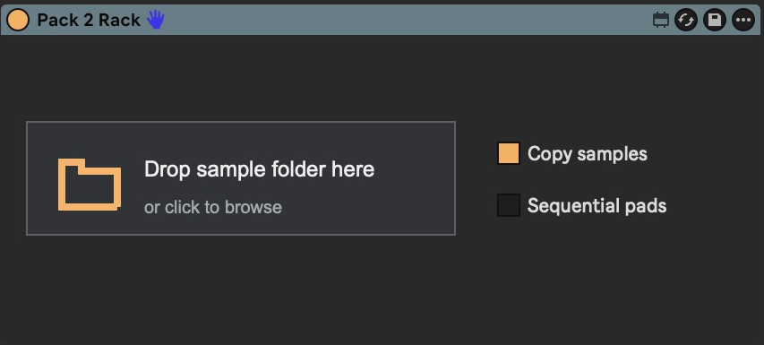
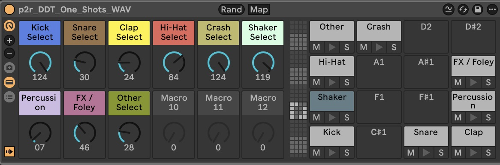
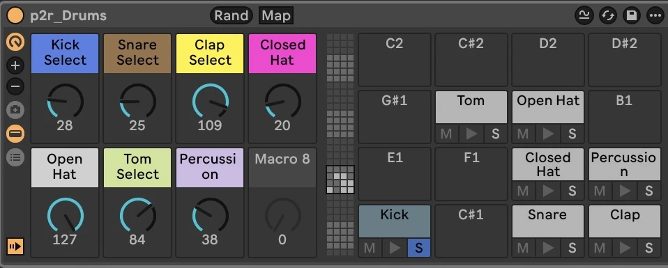

# Pack to Rack

## Make exploring sample packs easier—and a lot more fun.

Turn a folder of one-shots into a rack you can play, tweak, and explore. Hear your samples together, swap sounds as you go, and find combinations worth building a track around.



**[Download Pack 2 Rack.amxd](https://github.com/Michael-Schwartz-is/pack-to-rack/raw/refs/heads/main/dist/Pack%202%20Rack.amxd)**

Requires Ableton Live 12 with Max for Live, Sampler, and Max 9.1 or newer. Tested with Live 12.4.2 Suite / Max 9.1.4 on macOS. Load the device onto a MIDI track, drop a one-shots folder onto it, then click **Build Rack**. The single AMXD includes everything it needs; no separate Python or Node installation is required.

## Less clicking through folders. More hearing what works.

Exploring a sample pack can kill your momentum. Preview a kick, open another folder, audition a snare, try to imagine them together. It’s even harder when you’re working in a genre you don’t know as well.

You need to hear the sounds in context to know what fits.

```text
Drums / One-shots
├── Kicks
│   ├── kick_01.wav
│   └── kick_02.wav
├── Snares
│   ├── snare_01.wav
│   └── snare_02.wav
└── Hi-hats
    ├── hat_closed.wav
    └── hat_open.wav
```

## Your one-shots, ready to mix and match.

Pack to Rack turns your one-shots folder into a neatly organized rack with sample selectors and saves the samples to your User Library.

Start a pattern, then swap kicks, snares, hats, and other sounds while it plays. Explore the pack by making music with it.



## Roll the dice. Keep what clicks.

Randomize the sample selection for a quick sketch or a fresh starting point. Keep the combinations you like, change the sounds that don’t fit, and follow the idea.



## Runs locally. No telemetry.

Pack to Rack reads the sample folder you choose and saves the rack and copied samples to your Ableton User Library. It doesn’t upload data or collect telemetry.

The code is open source under the [MIT license](LICENSE).

## Like it? Send a little crypto.

If Pack to Rack makes digging through your samples more fun, you can send something my way.

Wallet address to be added.

## Credits

The bundled rack templates are derived from **[Ben Juodvalkis’ Ableton Device Creator](https://github.com/ben-juodvalkis/Ableton-Device-Creator)**, used under its MIT license. Thank you, Ben, for making those templates available.

The original attribution and license are preserved in [templates/LICENSE](templates/LICENSE) and the bundled device’s template folder. No donor audio is included. Sample-pack audio is supplied by the user; commercial sample packs are not included in this repository.

## Development

The [development notes](docs/development.md) cover the converter, CLI, rack mapping, tests, and limitations when moving exported racks between machines.

```sh
python3 -m unittest discover -s tests -v
node tests/test_single_amxd.cjs
```

To preview the website locally:

```sh
python3 -m http.server 4317 --directory website
```
